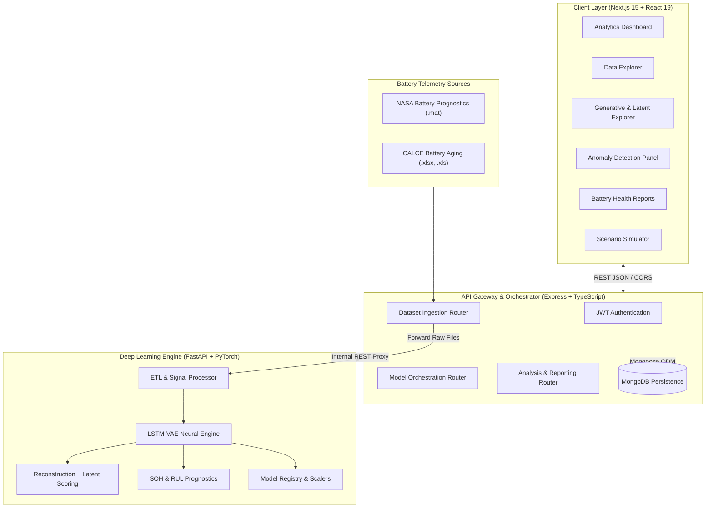

# BatteryLife AI System Architecture

## 1. High-Level Architecture Overview

BatteryLife AI employs a decoupled, production-style multi-service architecture designed for industrial EV battery diagnostics, simulation, and predictive maintenance.

---

## 2. Component Breakdown

### 2.1 AI Engine (`ai-service`)
* **Framework**: FastAPI (Python 3.10+) with PyTorch, NumPy, SciPy, and Scikit-learn.
* **ETL Pipeline**:
  - Ingests `.mat` (MATLAB) files and `.xlsx`/`.xls` (Excel spreadsheets).
  - Automatically identifies telemetry features: `voltage`, `current`, `temperature`, `capacity`.
  - Computes cumulative charge throughput via numerical integration ($Q = \frac{1}{3600}\int |I| dt$) if capacity measurements are absent.
  - Groups cycles by degradation stages (default: training on stages `0, 10, 20`; evaluation on `30, 40, 50`).
  - Generates sliding time windows of length $L=50$.
* **LSTM-VAE Neural Network**:
  - **Encoder**: LSTM network projecting sequence inputs into mean ($\mu$) and log-variance ($\log\sigma^2$) parameters.
  - **Reparameterization Trick**: $z = \mu + \epsilon \odot \sigma$ where $\epsilon \sim \mathcal{N}(0, I)$.
  - **Decoder**: LSTM network reconstructing sequence data from the latent vector $z$.
* **Diagnostic & Anomaly Scoring**:
  - Reconstruction Mean Squared Error: $\|x - \hat{x}\|_2^2$
  - Latent Mahalanobis / Euclidean distance: $\|\mu\|_2$
  - Combined anomaly scoring for early fault warning.

### 2.2 Backend Gateway (`backend`)
* **Framework**: Node.js, Express, TypeScript, Mongoose.
* **Responsibilities**:
  - User authentication and role-based access control via JWT.
  - Dataset metadata storage and file persistence.
  - Experiment tracking (`experiments` collection in MongoDB).
  - Model registry (`models` collection in MongoDB) tracking model versions and evaluation metrics.
  - Long-polling proxy to the AI Service for model training and simulation requests.

### 2.3 Frontend Dashboard (`frontend`)
* **Framework**: Next.js 15 (App Router), React 19, Tailwind CSS.
* **Capabilities**:
  - **Live Training Progress**: Real-time visualization of training epochs, loss convergence, and validation stats.
  - **Data Explorer**: Visual inspection of voltage, current, and temperature time-series curves.
  - **Generative Analysis**: Interactive PCA and t-SNE 2D/3D projections of the latent battery space.
  - **Scenario Simulation**: Temperature-conditioned degradation simulation under various thermal environments.
  - **Health Reports**: Comprehensive diagnostic reports indicating State of Health (SOH), estimated remaining cycles, risk stratification, and preventive maintenance actions.
